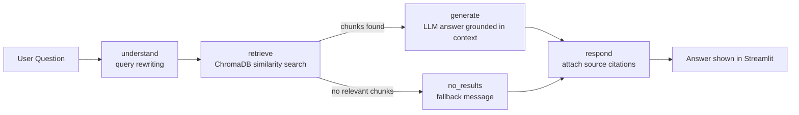

# Etisalat Egypt — Agentic Knowledge-Base Chatbot

A RAG (Retrieval-Augmented Generation) chatbot that answers questions about
Etisalat Egypt's mobile plans, built with **LangGraph**, **ChromaDB**, and
**OpenAI**, with a **Streamlit** chat UI.

Built for the Etisalat Egypt Internship Program 2026 — Phase 1 deliverable.

## Architecture



This mirrors the flow in the project brief (section 5): query understanding →
document retrieval → context assembly → response generation → response
delivery with citations. Each step is a LangGraph node; the conditional edge
after `retrieve` prevents the model from hallucinating when nothing relevant
is found in the knowledge base.

## Knowledge base

Source documents live in `data/raw/` (provided, not authored by this repo):

| File | Category |
|---|---|
| DataLine.docx | Mobile Data Plans (MiFi / USB modem) |
| PrepaidSystems.docx | Prepaid Plans (Aqwa Kart, Ahlan, daily, Guineih menu) |
| Emerald (2).docx | Postpaid Plans (Emerald family plans) |
| HekayaMixat.docx | Prepaid Plans (Hekaya Mix) |
| HekayaInternet.docx | Prepaid Plans - Internet Focused (Hekaya Internet) |

**Note on the brief's document-structure spec (section 4.2):** the source
documents already have clear titles and a clean heading hierarchy, but they
don't include explicit metadata tags (category/keywords/last-updated) or a
Q&A layer. Rather than hand-editing the Word files, `src/ingest.py` adds
that metadata programmatically at ingestion time (see the `DOC_METADATA`
dict) and tags every chunk with its source, title, heading path, and
ingestion date. This keeps the original documents untouched and makes it
easy to add new source docs later — just add one entry to `DOC_METADATA`.

## Setup

```bash
# 1. Clone and enter the repo
git clone <your-repo-url>
cd agentic-kb-chatbot

# 2. Create a virtual environment
python3 -m venv .venv
source .venv/bin/activate   # Windows: .venv\Scripts\activate

# 3. Install dependencies
pip install -r requirements.txt

# 4. Configure your API key
cp .env.example .env
# then edit .env and paste your OPENAI_API_KEY

# 5. Build the vector index (run once, or whenever data/raw changes)
python src/ingest.py

# 6. Launch the chatbot
streamlit run src/app.py
```

Or test from the command line without the UI:

```bash
python src/graph.py
```

## Project structure

```
agentic-kb-chatbot/
├── data/
│   ├── raw/            # source .docx knowledge base files
│   └── processed/      # chunks.json (generated, for review/debugging)
├── src/
│   ├── ingest.py        # parses docx -> chunks -> metadata -> ChromaDB
│   ├── graph.py          # LangGraph state machine (the agent)
│   └── app.py             # Streamlit chat UI
├── chroma_db/            # persisted vector store (generated, gitignored)
├── requirements.txt
├── .env.example
└── README.md
```

## Status / roadmap

- [x] Ingestion pipeline with metadata tagging and section-based chunking
- [x] LangGraph agent: understand → retrieve → generate → respond, with a
      no-results fallback
- [x] Streamlit chat interface with source citations
- [ ] Expand test coverage / edge cases (ambiguous queries, out-of-scope questions)
- [ ] Q&A pair extraction layer per document
- [ ] Deployment (Streamlit Community Cloud or internal server)
- [ ] Demo video + presentation slides

## Tech stack

| Layer | Technology |
|---|---|
| Agent framework | LangGraph |
| LLM | OpenAI API (`gpt-4o-mini` by default, configurable) |
| Embeddings | OpenAI `text-embedding-3-small` |
| Vector DB | ChromaDB (local, persistent) |
| UI | Streamlit |
